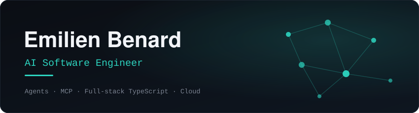

  

## 01 . Qui je suis

Ingénieur logiciel, je construis des systèmes d'agents qui livrent du code en production : orchestration de sessions Claude Code, serveurs MCP, mémoire partagée entre agents, CI qui fusionne seule ce qui est vert. Venu de la 3D et du VFX, j'ai gardé le goût du produit et de l'interface.

AI Software Engineer et référent interne IA et MCP chez **Amiltone**.

Mon travail personnel est dans des dépôts privés ; les projets ci-dessous sont décrits ici, avec une vitrine quand c'est possible.

---

## 02 . Ce que je construis

| Projet | Ce que c'est | Stack |
| :--- | :--- | :--- |
| **Klipia**  [Vitrine](https://github.com/BlueeShark/klipia-showcase) | SaaS de publication multi-comptes : une vidéo devient des variantes différentes (accroche, montage, horaire) publiées sur sept réseaux par leurs API officielles, avec validation humaine. Serveur MCP pour piloter son espace depuis Claude ou ChatGPT. Développé par des agents Claude Code orchestrés par ticket, avec revue, audit de sécurité et critiques visuelles automatiques, puis une file de push qui fusionne les PR vertes. | Next.js 16, React 19, TypeScript, PostgreSQL, Drizzle, Vercel, Cloudflare R2, Claude API, MCP SDK |
| **Atlas** | Mémoire persistante partagée par mes agents : un vault Markdown, un fichier par sujet, des entrées datées qui se remplacent sans s'effacer. Les agents l'éditent directement, une curation de nuit relit et range les nouvelles entrées, un index plein texte sert la recherche et la lecture « vrai à telle date ». Chaque agent reçoit en début de session un noyau de ce qu'il doit savoir. | Python, SQLite FTS5, Markdown, Claude Code hooks |
| **Agentic OS** | Bientôt. | |

---

## 03 . Outils et expertise

* **Agents :** Claude Code ∙ Orca (ADE : bots, workers, automations) ∙ OpenClaw ∙ sous-agents et skills
* **Protocoles et API :** MCP (serveurs Streamable HTTP, OAuth) ∙ Claude API ∙ OpenAI API
* **Organisation :** Linear ∙ GitHub (PR, rulesets, Actions self-hosted) ∙ ADR et journal de décisions
* **Langages :** TypeScript ∙ Python ∙ JavaScript ∙ Java
* **Web et données :** Next.js ∙ React ∙ Node.js ∙ PostgreSQL ∙ Drizzle ∙ SQLite
* **Cloud :** Vercel ∙ Cloudflare R2 ∙ AWS (ECS, API Gateway, Lambda, Bedrock)
* **Tests :** Vitest ∙ Testing Library ∙ Playwright ∙ TDD

---

## 04 . Me joindre

* **LinkedIn** : [/emilien-benard](https://www.linkedin.com/in/emilien-benard)
* **Email** : [emilien.benard2@gmail.com](mailto:emilien.benard2@gmail.com)
